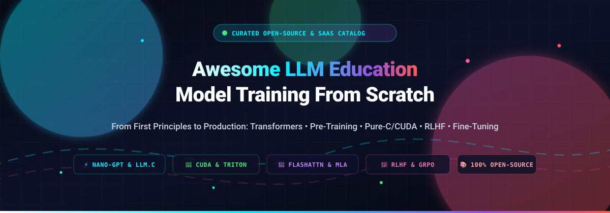

# Awesome LLM Education & Model Training From Scratch 🚀

  

# 🎓 Awesome LLM Education: Model Training From Scratch 🧠

  <strong>The definitive, curated guide to mastering Large Language Models (LLMs) from first principles, pure C/CUDA, and PyTorch to distributed pre-training, reasoning models, and production RLHF alignment.</strong>

  
  
  
  
  
  
  

  🌟 <em>Star this repository if you find it helpful for your AI and LLM engineering journey!</em> 🌟

---

## 📌 Overview & SEO Summary 🔍

Welcome to **Awesome LLM Education & Model Training From Scratch**! This repository is an open-source index designed for AI engineers, machine learning researchers, and deep learning practitioners who want to learn how foundation models work from the ground up. Whether you are looking for:

- **End-to-End LLM Pre-Training Frameworks** in Python, PyTorch, C, CUDA, and Rust.
- **Low-Level Transformer Implementations** covering Self-Attention, Multi-Head Latent Attention (MLA), FlashAttention, and BPE Tokenization.
- **Post-Training & Alignment Techniques** including Supervised Fine-Tuning (SFT), Reinforcement Learning from Human Feedback (RLHF), Direct Preference Optimization (DPO), and Group Relative Policy Optimization (GRPO) reasoning models.
- **Top Commercial SaaS & Hosted AI Learning Platforms** benchmarked by company valuation, pricing tiers, and free trial allowances.

---

## 📑 Table of Contents 📖

- [📊 Sector Overview & Market Dynamics](#-sector-overview--market-dynamics)
- [💻 SaaS/Hosted Platforms](#-saashosted-platforms)
- [🛠️ Open-Source Equivalents & Tools](#️-open-source-equivalents--tools)
  - [🏗️ Complete End-to-End LLM From-Scratch Repositories](#️-complete-end-to-end-llm-from-scratch-repositories)
  - [⚡ Minimalist & Pure-C / CUDA / Rust LLM Training Implementations](#-minimalist--pure-c--cuda--rust-llm-training-implementations)
  - [🔬 Tokenization, Attention & Architecture Deep-Dive Guides](#-tokenization-attention--architecture-deep-dive-guides)
  - [🎯 Post-Training, Fine-Tuning, RLHF & Reasoning From Scratch](#-post-training-fine-tuning-rlhf--reasoning-from-scratch)
  - [📚 Open-Source AI Courses, Books & Interactive Curricula](#-open-source-ai-courses-books--interactive-curricula)
- [📈 Star History](#-star-history)
- [💖 Support & Sponsorship](#-support--sponsorship)
- [🤝 Contributing](#-contributing)

---

## 📊 Sector Overview & Market Dynamics 🌐

The global AI in education and digital tech upskilling market is estimated at approximately **$5.0B to $7.0B** (expanding at an aggressive CAGR of >30% toward $60B+ by the mid-2030s). The sector is **highly fragmented** rather than winner-take-all, characterized by low market concentration where leading platforms collectively hold under 20% market share alongside university MOOCs, specialized coding sandboxes, and niche developer upskilling tools.

---

## 💻 SaaS/Hosted Platforms ☁️

Commercial, cloud-hosted AI education platforms, interactive coding sandboxes, and subscription-based machine learning certification programs. Sorted in descending order by company valuation / scale.

| Platform | Company Scale (Valuation / Revenue) | Starting Pricing (Paid Tier) | Free Tier / Trial Limits | Description |
| :--- | :--- | :--- | :--- | :--- |
| **[Kaggle](https://kaggle.com)** | ~$2.2T parent market cap (Alphabet/Google subsidiary; acquired 2017) | Free ($0 / mo, no paid tier; compute quota capped) | Free forever: 30 hrs/wk NVIDIA T4 GPU compute (max 12h/session) & 20 hrs/wk TPU v5e/v3-8 compute (max 9h/session); 20 min idle timeout | Google-hosted data science & ML platform offering free GPU/TPU-accelerated Jupyter notebooks, micro-courses, and open community datasets. |
| **[Coursera](https://coursera.org)** | ~$1.35B public market cap (NYSE: COUR; FY24 revenue ~$695M) | $59.00 / month (Coursera Plus monthly) or $399.00 / year | 7-day free trial for Coursera Plus (full catalog access; auto-renews); free course preview limited to first module/lecture videos only (no graded items or certificates) | Hosted online learning platform featuring university-backed AI specializations, graded cloud notebooks, and verified certificates. |
| **[edX](https://edx.org)** | $800M acquisition valuation by 2U; 2U revenue ~$945M | $50.00 / course (Verified Track starting price; programs $200–$1,500+) | Free audit track available per course: limited strictly to video lectures and un-graded reading materials for a temporary course access window (no graded assignments or certificates) | Hosted academic learning platform providing university-level machine learning, deep learning, and foundation model courses. |
| **[DataCamp](https://datacamp.com)** | ~$625M private valuation ($100M+ ARR milestone) | $13.00 / month (billed annually at $156/yr for Premium, or $35/mo month-to-month) | Free forever Basic plan: strictly limited to the first chapter/lesson only of courses across the catalog (no certificates, complete skill paths, or graded projects) | Interactive browser-based learning platform featuring guided Python, PyTorch, Hugging Face, and LLM fine-tuning tracks. |
| **[Codecademy](https://codecademy.com)** | $525M acquisition valuation by Skillsoft (~$42M ARR at acquisition) | $14.99 / month (billed annually for Plus, or $29.99 month-to-month; Pro starts at $17.49/mo) | Free forever Basic tier: limited to ~20 introductory basic courses (no structured skill/career paths, quizzes, real-world portfolio projects, or certificates) | Cloud-hosted interactive coding platform offering step-by-step NLP, transformer, and generative AI developer paths. |
| **[Brilliant.org](https://brilliant.org)** | ~$305M private valuation (~$10M–$50M est. annual revenue) | $13.49 / month (billed annually at $161.88/yr for Premium, or $24.99 month-to-month) | Free forever tier: strictly limited to 2 daily problem keys per day (keys reset at midnight; unlocks 2 interactive concepts daily; sequential progression only, no skipping ahead) | Commercial interactive visual learning platform teaching the math, probability, and intuition behind neural networks and LLMs. |
| **[Udacity](https://udacity.com)** | ~$100M+ scale (acquired by Accenture LearnVantage in 2024; $1B peak 2015 valuation) | $249.00 / month (or 4-month bundle at ~$846 upfront) | 7-day free trial via select promotions (requires credit card, auto-renews; certificate creation locked during trial); free unverified course catalog limited strictly to raw video lectures | Commercial nanodegree platform offering mentor-supported deep learning, NLP, and generative AI engineering tracks with GPU workspaces. |
| **[DeepLearning.AI](https://deeplearning.ai)** | ~$52M–$79M est. annual revenue ($100M+ cumulative Coursera platform sales) | $30.00 / month (DeepLearning.AI Pro monthly, or $25/mo billed annually at $300/yr) | Free forever tier: video lectures and community forum access only; 7-day free trial for Pro (full interactive lab and graded quiz access; requires payment info, auto-renews) | Founded by Andrew Ng, offering hands-on AI engineering courses, short courses on transformers and agentic AI, and hosted Jupyter lab environments. |
| **[Pluralsight](https://pluralsight.com)** | Enterprise scale ($1.3B debt restructuring / lender recapitalization in 2024; $3.5B Vista 2021 buyout) | $29.00 / month (Standard Tech library, or $299.00 / year for Complete catalog) | 10-day free trial (requires credit card upfront; auto-renews unless canceled; full offline downloads and select cloud sandbox environments restricted during trial) | Enterprise technology learning platform offering video courses, skill assessments, and cloud sandboxes for AI model development. |

---

## 🛠️ Open-Source Equivalents & Tools 💻

Free and open-source software (FOSS) educational repositories, line-by-line from-scratch LLM implementations, minimal C/CUDA trainers, and community-driven AI courses. Sorted by GitHub stars in descending order within each category.

### 🏗️ Complete End-to-End LLM From-Scratch Repositories

* **[LLMs-from-scratch (Sebastian Raschka)](https://github.com/rasbt/LLMs-from-scratch)**  - Bestselling companion repository implementing a ChatGPT-like LLM step-by-step in PyTorch—covering tokenization, multi-head attention, pre-training, and instruction fine-tuning.
* **[nanoGPT (Andrej Karpathy)](https://github.com/karpathy/nanoGPT)**  - The gold standard repository for training and fine-tuning medium-sized GPT models in ~600 lines of clean, hackable PyTorch.
* **[LitGPT (Lightning AI)](https://github.com/Lightning-AI/litgpt)**  - Hackable, clean implementations of 20+ foundation model architectures (Llama 3, Gemma 2, Mistral, Phi) with zero-abstraction pre-training and LoRA scripts.
* **[train-llm-from-scratch (Fareed Khan)](https://github.com/FareedKhan-dev/train-llm-from-scratch)**  - Comprehensive step-by-step open-source notebook series covering data collection, architecture construction, pre-training, and evaluation.
* **[TinyLlama](https://github.com/jzhang38/TinyLlama)**  - Open-source project pre-training a 1.1B Llama model on 3 trillion tokens with complete transparent training logs, FlashAttention-2, and reproducible configs.
* **[llama-models (Meta Llama)](https://github.com/meta-llama/llama-models)**  - Official Meta repository containing standalone reference model code and tokenizers for Llama 3/3.1/3.2/3.3 from scratch.
* **[OLMo (Allen Institute for AI)](https://github.com/allenai/OLMo)**  - Truly open foundation model suite providing full pre-training code, model weights, training data pipelines (Dolma), and evaluation harnesses.
* **[Nanotron / SmolLM (Hugging Face)](https://github.com/huggingface/nanotron)**  - Minimalist, fast 3D-parallelism training framework written in PyTorch used to train SmolLM models from scratch with production-grade efficiency.

### ⚡ Minimalist & Pure-C / CUDA / Rust LLM Training Implementations

* **[llm.c (Andrej Karpathy)](https://github.com/karpathy/llm.c)**  - Pure C and CUDA implementation of GPT-2/GPT-3 training directly on bare metal without Python or heavy deep learning framework dependencies.
* **[candle (Hugging Face Rust ML)](https://github.com/huggingface/candle)**  - Minimalist ML framework for Rust featuring clean, readable from-scratch implementations of Llama, Mistral, Whisper, and BERT.
* **[llama2.c (Andrej Karpathy)](https://github.com/karpathy/llama2.c)**  - Inference and training of Llama 2 architectures in one single file of pure C with zero dependencies.
* **[micrograd (Andrej Karpathy)](https://github.com/karpathy/micrograd)**  - Tiny scalar-valued autograd engine and neural network library in ~150 lines of Python designed to teach backpropagation from first principles.
* **[makemore (Andrej Karpathy)](https://github.com/karpathy/makemore)**  - Step-by-step autoregressive character-level language model series progressing from bigrams and MLPs to WaveNet and Transformers.
* **[picoGPT (Jay Mody)](https://github.com/jaymody/picoGPT)**  - Unnecessarily tiny, educational implementation of GPT-2 forward pass in ~40 lines of pure NumPy.

### 🔬 Tokenization, Attention & Architecture Deep-Dive Guides

* **[DeepSeek-V3 Walkthrough (deepseek-ai)](https://github.com/deepseek-ai/DeepSeek-V3)**  - Official reference implementation demonstrating Multi-Head Latent Attention (MLA), Multi-Token Prediction (MTP), and DeepSeekMoE routing from scratch.
* **[FlashAttention (Tri Dao)](https://github.com/Dao-AILab/flash-attention)**  - Fast and memory-efficient exact attention algorithms with IO-awareness and custom CUDA kernels for high-throughput Transformer training.
* **[Llama 3 from Scratch (naklecha)](https://github.com/naklecha/llama3-from-scratch)**  - Detailed, visual tensor-by-tensor implementation of Meta Llama 3 architecture (RoPE, GQA, SwiGLU, RMSNorm) written in pure PyTorch.
* **[minbpe (Andrej Karpathy)](https://github.com/karpathy/minbpe)**  - Minimal, clean, educational Byte Pair Encoding (BPE) tokenizer implementation written from scratch in Python (the exact algorithm behind GPT-4).
* **[The Annotated Transformer (Harvard NLP)](https://github.com/harvardnlp/annotated-transformer)**  - Line-by-line annotated PyTorch implementation and walkthrough of the foundational Attention Is All You Need paper.
* **[Tensor Puzzles (Sasha Rush)](https://github.com/srush/Tensor-Puzzles)**  - Interactive visual puzzles and challenges for mastering tensor operations, broadcasting, and low-level ML indexing in pure Python/NumPy.

### 🎯 Post-Training, Fine-Tuning, RLHF & Reasoning From Scratch

* **[Unsloth](https://github.com/unslothai/unsloth)**  - Ultra-fast LLM fine-tuning framework providing custom Triton kernels, 80% lower VRAM usage, and free Colab/Kaggle recipes for Llama, Qwen, and Gemma.
* **[LLaMA-Factory](https://github.com/hiyouga/LLaMA-Factory)**  - Easy-to-use unified efficient fine-tuning framework supporting 100+ LLMs with WebUI, LoRA, QLoRA, and RLHF (DPO/KTO/PPO).
* **[TRL - Transformer Reinforcement Learning (Hugging Face)](https://github.com/huggingface/trl)**  - Full-stack open-source library for post-training foundation models using SFT, Reward Modeling, PPO, DPO, and GRPO.
* **[TinyZero (Jiayi Pan)](https://github.com/Jiayi-Pan/TinyZero)**  - Minimal reproduction of DeepSeek-R1-Zero demonstrating emergent reasoning behaviors via pure reinforcement learning on sub-3B parameter models.
* **[reasoning-from-scratch (Sebastian Raschka)](https://github.com/rasbt/reasoning-from-scratch)**  - Step-by-step educational codebase demonstrating how to build reasoning LLMs using inference-time scaling, GRPO, and reinforcement learning.
* **[The Alignment Handbook (Hugging Face)](https://github.com/huggingface/alignment-handbook)**  - Robust recipes and production-ready scripts to align language models with DPO, ORPO, and Supervised Fine-Tuning.

### 📚 Open-Source AI Courses, Books & Interactive Curricula

* **[Large Language Model Course (Maxime Labonne)](https://github.com/mlabonne/llm-course)**  - Comprehensive roadmap and practical notebooks covering LLM fundamentals, fine-tuning, quantization, evaluation, and LLM applications.
* **[Dive into Deep Learning (d2l.ai)](https://github.com/d2l-ai/d2l-en)**  - Comprehensive open-source interactive textbook with runnable PyTorch, JAX, and TensorFlow code across 100+ deep learning chapters.
* **[Neural Networks: Zero to Hero (Andrej Karpathy)](https://github.com/karpathy/nn-zero-to-hero)**  - Free video lecture series and interactive Jupyter notebooks building micrograd, makemore, and GPT from scratch.
* **[fast.ai - Practical Deep Learning for Coders](https://github.com/fastai/course22)**  - Free top-down deep learning course teaching neural networks, NLP, and modern computer vision from practical foundations to transformers.

---

## 📈 Star History 📊

---

## 💖 Support & Sponsorship ☕

Thank you so much for exploring and supporting **Awesome-LLM-Education-Model-Training-From-Scratch**! 🎉

If you find this curated collection useful for your learning, teaching, or open-source AI projects:
- ⭐ **Star this repository** to help others discover it!
- 🍴 **Fork the repo** to contribute new models, guides, and courses.
- 📢 **Share with fellow AI engineers and students** across Twitter/X, LinkedIn, and Discord.
- ☕ **Buy me a coffee / Become a sponsor:** If you would like to support ongoing curation and development of AI education resources, visit the [GitHub Sponsors Dashboard](https://github.com/sponsors/ishandutta2007). Your support is deeply appreciated!

---

## 🤝 Contributing ✨

Contributions are always welcome! Feel free to open a Pull Request or Issue to add more open-source from-scratch LLM implementations, educational transformer repositories, or free AI curricula.

1. Fork the repository.
2. Add your project under the appropriate category with a concise description and GitHub stars badge.
3. Submit a Pull Request.

---

  Maintained with ❤️ by <a href="https://github.com/ishandutta2007">Ishan Dutta</a> and the open-source AI community.

